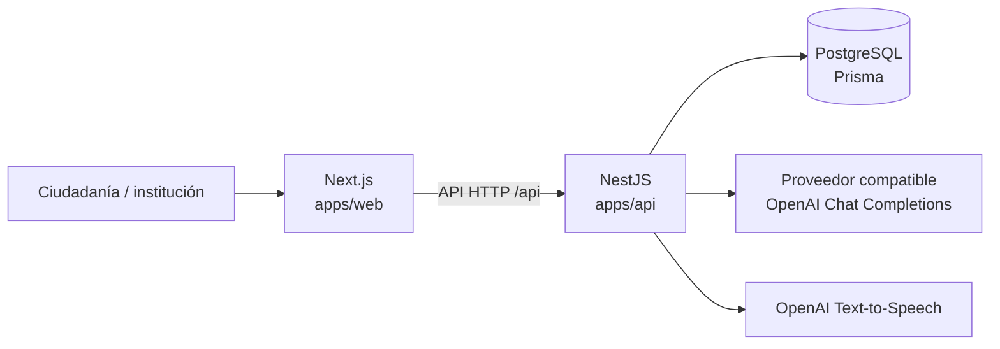

# Arquitectura de Rimay

## Componentes

- **Web:** aplicación Next.js. Las rutas públicas `/`, `/c/:id` y `/preguntar` muestran contenido de demostración; el formulario público aún no guarda preguntas ni llama a la API.
- **API:** NestJS con prefijo global `/api`. Los módulos de comunicados y preguntas usan PostgreSQL mediante Prisma. El asistente usa un comunicado publicado como contexto. Gap Detector y traducción llaman al proveedor LLM sin guardar el resultado. Audio devuelve MP3 codificado en base64 y no lo persiste.
- **LLM:** `shared/ai/LlmClient` envía solicitudes JSON al endpoint Chat Completions configurado por `LLM_BASE_URL`, `LLM_MODEL` y `LLM_API_KEY`.
- **Base de datos:** Prisma administra `Communique`, `CommuniqueTranslation` y `Question`. El esquema actual no almacena hallazgos del Gap Detector ni archivos de audio.

## Flujos disponibles en `main`

| Flujo | Endpoint | Dependencias |
| --- | --- | --- |
| Listar comunicados publicados | `GET /api/communiques` | PostgreSQL |
| Consultar un comunicado publicado | `GET /api/communiques/:slug` | PostgreSQL |
| Recibir una pregunta ciudadana | `POST /api/questions` | PostgreSQL |
| Responder sobre un comunicado | `POST /api/assistant/answer` | PostgreSQL y LLM |
| Detectar información faltante y ambigüedades | `POST /api/gap-detector/analyze` | LLM |
| Traducir al quechua boliviano | `POST /api/translation/to-quechua` | LLM |
| Generar voz MP3 | `POST /api/audio/synthesize` | `TTS_API_KEY` |

Las rutas web y los endpoints de API son independientes: la web pública sigue usando datos de demostración. La calidad de la traducción y, en particular, de la pronunciación en quechua requiere validación con hablantes.

## Límites actuales

- La web no implementa autenticación institucional.
- Las preguntas enviadas por API quedan pendientes de revisión; no hay una interfaz pública para leerlas o responderlas.
- El radar de confusión, el flujo de aclaraciones y el dashboard institucional no están disponibles en `main` mientras sus módulos se desarrollan e integran.
- El audio generado es efímero. Para ofrecer URLs persistentes se necesitaría definir y configurar un almacenamiento de archivos.
